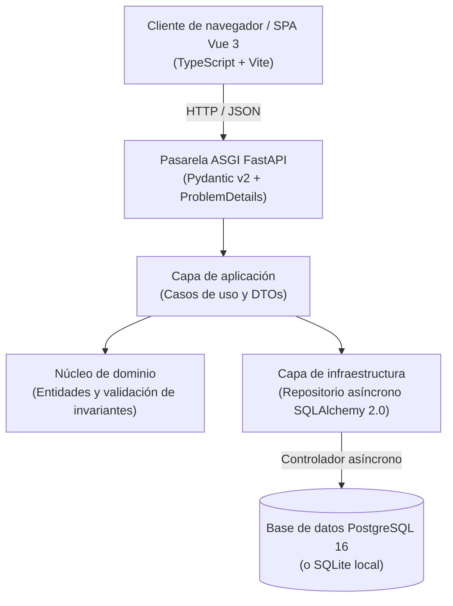

# Plantilla Full Stack con Clean Architecture

[](README.md)
[](#)
[](docs/20-architecture.md)
[](https://fastapi.tiangolo.com/)
[](https://vuejs.org/)
[](LICENSE)

Plantilla de inicio de nivel de producción para aplicaciones full-stack: **Python (FastAPI)**, **Vue 3 (TypeScript)** y **PostgreSQL** con 0,00 € de coste operativo.

Diseñada para inicialización rápida de proyectos, modelado estricto de dominio y gobernanza unificada.

## Arquitectura (Modelo C4)



## Stack tecnológico

- **Backend**: Python 3.12, FastAPI, Pydantic v2, SQLAlchemy 2.0 Async, Uvicorn.
- **Frontend**: Vue 3 (Composition API), TypeScript estricto, Vite, CSS puro.
- **Datos**: PostgreSQL 16 (producción), `sqlite+aiosqlite` (desarrollo local sin dependencias).
- **Navegación**: Barra de navegación unificada `<nain-ecosystem-bar>`.
- **Gobernanza**: Flujos reutilizables de GitHub Actions (`Nain9Dev/.github`).

## Inicio rápido (desarrollo local)

### 1. Docker Compose (Stack completo)

Ejecuta el stack completo con PostgreSQL, FastAPI y Vue 3 con un solo comando:

```bash
docker compose up --build
```

- Frontend: <http://localhost:5173>
- Backend API: <http://localhost:8000>
- Documentación Swagger: <http://localhost:8000/docs>

### 2. Ejecución local manual

**Backend**:
```bash
cd backend
python -m venv .venv
source .venv/bin/activate  # En Windows: .venv\Scripts\activate
pip install -e ".[dev]"
pytest
uvicorn app.main:app --reload --port 8000
```

**Frontend**:
```bash
cd frontend
npm install
npm run dev
```

## Estándares de calidad y pruebas

- Pruebas unitarias de dominio con `pytest`.
- Verificaciones automatizadas de idoneidad arquitectónica (`test_architecture.py` con AST).
- Tipado estricto en backend (`mypy --strict`) y frontend (`vue-tsc`).
- Reglas de linter con `ruff`.

## Licencia

Distribuido bajo la [Licencia MIT](LICENSE).
