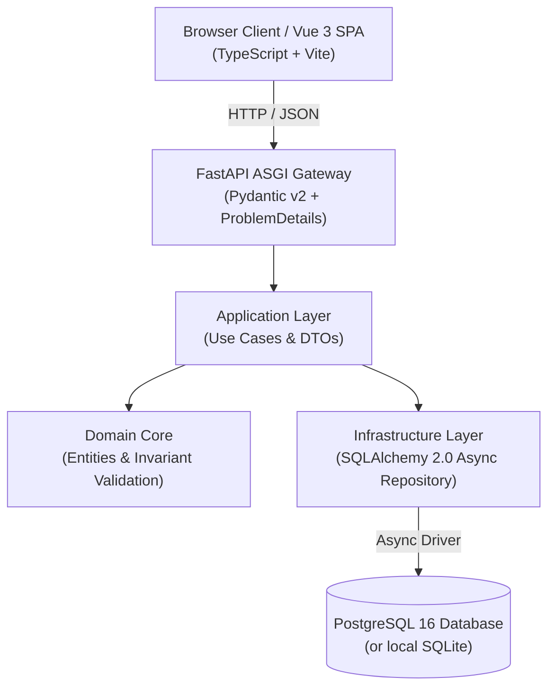

<picture>
  <source media="(prefers-color-scheme: dark)" srcset="docs/assets/banner-dark.svg">
  <source media="(prefers-color-scheme: light)" srcset="docs/assets/banner-light.svg">
  
</picture>

# Full Stack Clean Architecture Template

[](#)
[](README.es.md)
[](docs/20-architecture.md)
[](https://fastapi.tiangolo.com/)
[](https://vuejs.org/)
[](LICENSE)

Production-grade starter template for full-stack applications: **Python (FastAPI)**, **Vue 3 (TypeScript)**, and **PostgreSQL** with 0.00 € operational expense.

Designed for rapid project bootstrapping, strict domain modeling, and unified governance.

## Architecture (C4 Model)



## Tech Stack

- **Backend**: Python 3.12, FastAPI, Pydantic v2, SQLAlchemy 2.0 Async, Uvicorn.
- **Frontend**: Vue 3 (Composition API), TypeScript strict, Vite, Vanilla CSS.
- **Data**: PostgreSQL 16 (production), `sqlite+aiosqlite` (zero-dependency local development).
- **Navigation**: Integrated `<nain-ecosystem-bar>` for seamless suite navigation.
- **Governance**: Reusable GitHub Actions workflows (`Nain9Dev/.github`).

## Quick Start (Local Development)

### 1. Docker Compose (Complete Stack)

Run the full stack with PostgreSQL, FastAPI, and Vue 3 in one command:

```bash
docker compose up --build
```

- Frontend: `http://localhost:5173`
- Backend API Docs (Swagger): `http://localhost:8000/docs`
- Health Endpoint: `http://localhost:8000/api/v1/health`

### 2. Standalone Backend (Zero Docker)

```bash
cd backend
python -m venv .venv
source .venv/bin/activate  # On Windows: .venv\Scripts\activate
pip install -r requirements.txt
uvicorn app.main:app --reload
```

## Running Tests

```bash
# Backend unit & integration tests
cd backend
python -m pytest tests -v

# Frontend typechecking & build
cd frontend
npm install
npx tsc --noEmit
npm run build
```

## Zero-Cost Cloud Deployment (0.00 €)

1. **Database**: Free serverless PostgreSQL on [Neon](https://neon.tech/) or [Supabase](https://supabase.com/).
2. **Backend**: Container service on [Render](https://render.com/) or [Fly.io](https://fly.io/) (free tier).
3. **Frontend**: Static edge deployment on [Cloudflare Pages](https://pages.cloudflare.com/) or [GitHub Pages](https://pages.github.com/).

## Specifications & Decision Records

Detailed requirements and architectural decision records are organized under `docs/`:
- [`docs/10-requirements.md`](docs/10-requirements.md): Functional EARS requirements.
- [`docs/30-decisions/ADR-0001-clean-architecture.md`](docs/30-decisions/ADR-0001-clean-architecture.md): Architectural decision record.
